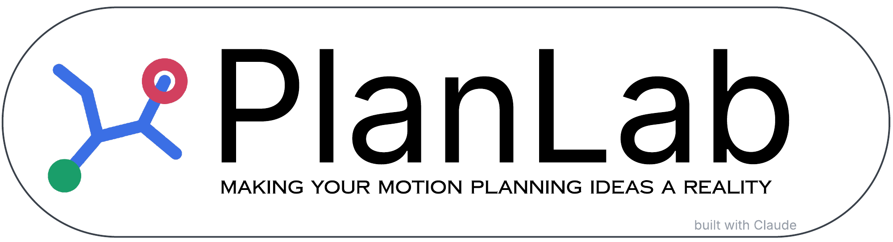

Build a 2D workspace, write a motion planner in pseudocode (with your own Python functions if you like), and watch
it search step by step. It comes with RRT, RRT reward-penalty, RRT-Connect, RRT\*, Informed RRT\*, Lazy RRT, PRM,
PRM\*, Lazy PRM, BIT\*, ABIT\* and AIT\*.

## Installation

### What you need

- **VS Code** 1.85 or newer.
- **Python 3**, to build the extension and to run your own Python functions. Any interpreter works, including a
  virtual environment. Packages your functions import (numpy, matplotlib, …) must be installed in it.
- Optional: Microsoft's **Python** extension for VS Code, to pick the interpreter with **Python: Select Interpreter**.

### Install the PlanLab extension

1. In a terminal, in the PlanLab folder, build the extension:
   ```
   python3 tools/build_vsix.py
   ```
   This writes `dist/planlab.vsix`. No Node.js or npm is needed.
2. In VS Code: **Extensions** view → **⋯** → **Install from VSIX…** → choose `dist/planlab.vsix`.
   Or in a terminal: `code --install-extension dist/planlab.vsix`.
3. Click the **PlanLab** icon in the activity bar, then **Open PlanLab**. PlanLab opens in an editor tab.

### Open your PlanLab folder in VS Code

Use **File → Open Folder…** on the PlanLab folder, or on the folder that contains it (like `~/Downloads`). PlanLab
then runs from that folder:

- The Python tab is saved as the file `python/functions.py`, which you can also edit in VS Code.
- Saved changes to PlanLab's files load by themselves.

Without the folder open, PlanLab runs the copy installed with the extension. To always use a particular folder,
set **`planlab.appFolder`** in VS Code's settings.

### Choose the Python for your functions

PlanLab uses the interpreter selected in VS Code (**Python: Select Interpreter**). To use a different one only for
PlanLab, set **`planlab.pythonPath`**. **Check Python** in the Python tab shows which one runs your functions.

### Updating

After changing PlanLab's files, press **Reload PlanLab** in the PlanLab sidebar (it also restarts Python). Build and
install the `.vsix` again only when `vscode/extension.js` or `package.json` have changed.

### Without VS Code

Open `index.html` in a web browser, or run `python3 tools/build.py` to make `dist/planlab.html`, PlanLab in a single
file you can share. Everything works except Python functions, and your work is saved in that browser only.

## Using PlanLab

PlanLab has four windows. Drag the dividers between them to resize them, and double-click a divider to reset it.

| Window | What it's for |
|---|---|
| **1 Workspace** | The 100 × 100 world the planner searches. Trees, roadmaps and paths are drawn here as the run goes. |
| **2 Objects** | The start, goals, goal samples, obstacles and ready-made layouts. |
| **3 Pseudocode** | Tabs **Algorithm**, **Functions**, **Python** and **Reference**. |
| **4 Run** | Run and step, speed, seed, the checks before a run, numbers, **Variables** and **Output**. |

At the top right, the status shows what the planner is doing (**Ready**, **Running**, **Path found**, …). The switch
next to it gives PlanLab light or dark colours. Until you use it, PlanLab follows VS Code's theme (or the system's in a
browser); it never changes VS Code's own colours.

### 1. Set up the workspace

- **Add objects:** drag **q_start**, **q_goal**, a **Goal region** or an obstacle from Objects into the Workspace.
- **Change them:** drag an object to move it, drag a corner to resize it, and drag the round handle to rotate it.
  Arrow keys nudge the selected object.
- **Remove them:** press **Delete**, drag the object off the Workspace, or click **Remove** in Objects.
- **Selected object:** Objects shows its size, its **Weight** (for a goal), and buttons to rotate it by 15° (for an
  obstacle).
- **Layouts:** the menu loads a ready-made workspace (four blocks, narrow passage, bug trap, zig-zag, three goal
  regions, two weighted goals). **Clear obstacles** and **Clear all** start over.
- **Goal samples:** each goal region gives the planner a few collision-free points to aim for, shown as dots. Set how
  many with **Per region**. **Random** or **Consecutive** sets how `sample_goal()` picks one.

### 2. Run a planner

- **Pick an algorithm** in the menu of the Algorithm tab.
- **Run planner** runs it. The button then becomes **Pause**, **Resume** or **Run again**.
- **Step line** runs one line of pseudocode. On the Functions tab, it goes into your functions line by line.
- **Next expansion** runs until a tree or roadmap gains an edge. **Reset** clears the run.
- **Speed** sets how many lines of pseudocode run per second.
- **Checks:** a run only starts once these hold:
  - `q_start` and at least one goal are placed;
  - `q_start` and every `q_goal` are outside obstacles, and obstacles don't cover all of the goal regions;
  - the pseudocode has no errors.

  If something is missing, a note in the Workspace says what.
- **Seed:** all of a run's random numbers come from it, so the same seed, workspace and code give the same run.
  **New** picks another seed.
  - **Randomise each run** gives every run a new seed.
  - **Run repeatedly** runs again and again and keeps a tally of the results.
- **Numbers:** lines run, vertices, edges added and path length. **Variables** shows the algorithm's variables;
  **Output** shows messages and `print` output.

### 3. Write and change algorithms

- **Edit** the algorithm in the Algorithm tab. Your edits are kept, and **Restore original** brings back the built-in
  version.
- **Your own algorithms:** **+ New** starts an empty one and **Save a copy** copies the current one. Your own
  algorithms can also be renamed and deleted.
- **The workspace in pseudocode:** `q_start`, `q_goal`, `goal_region`, `goals`, `goal_weights` and `goal_samples`.
  Return a path (a list of points) to have it drawn, or `failure`.
- **The language:** the **Reference** tab lists the syntax and every built-in function. `<-` and `:=` work in place
  of `←`. A complete example, a basic RRT:
  ```
  T ← new_tree(q_start)
  for k ← 1 to 2000 do
    q_rand ← sample_free()
    q_near ← nearest(T, q_rand)
    q_new ← steer(q_near, q_rand, 4)
    if collision_free(q_near, q_new) then
      add_vertex(T, q_new)
      add_edge(T, q_near, q_new)
      if in_goal(q_new, 3) then
        return path(T, q_new)
      end if
    end if
  end for
  return failure
  ```
  or if you want to see a gridmap in matplotlib of the environment created in your workspace:
  ```
  grid ← []
  for j ← 0 to 99 do
    row ← []
    for i ← 0 to 99 do
      append(row, is_free(point(i + 0.5, j + 0.5)))
    end for
    append(grid, row)
  end for
  free ← show_grid(grid)
  return failure
  ```

- **Your functions:** **+ New function** in the Functions tab adds a pseudocode function that every algorithm can
  call. **Edit a built-in…** copies a built-in's pseudocode into the Functions tab (or wraps it), and your version
  then replaces it. `builtin.name(…)` still calls the original. **Jump to:** finds your functions.
- **Errors** show under the editors with their tab and line. **Show** jumps to the line.

### 4. Python functions (VS Code only)

Write `def` functions in the Python tab (or **+ New Python function**) and call them from pseudocode like any other
function: `c ← path_cost(P)`. **Open functions.py** opens the tab's file in VS Code. Your other modules in `python/`
can be imported.

- **Points** arrive as `Point` objects (`p.x`, `p.y`, `+ - * /`). Give back a `Point` or an `(x, y)` tuple.
- **Lists** arrive as lists.
- **Trees, graphs, sets, maps and queues** arrive as handles you can give back but not look into.
- A point that comes back unchanged is the same point (a tree vertex stays a vertex).
- **Ready to use:** `dist`, `norm`, `steer`, `Point`, `inf` and `failure`. `print()` writes to the Output tab, and
  `import random` follows the run's seed.
- **Names:** a Python function with a built-in's name replaces it. A name can't be both a pseudocode and a Python
  function.
- **Calls:** a call runs in one go (Step line steps over it). An error shows at the calling line, with the Python
  line. A call that takes over 10 seconds is stopped and Python restarts.

### About the built-in algorithms

- **Goal samples:** planners aim at the goal samples. BIT\*, ABIT\* and AIT\* aim at all of them and add more each
  batch, and RRT reward-penalty picks them by weight. In pseudocode they are `goal_samples` and `GOAL_CHOICE`.
- **Informed sampling:** once a planner has a path of cost c, only points x with dist(q_start, x) + dist(x, goal) < c
  can improve it. That region is a prolate hyperspheroid (an ellipse in 2D) per goal, and the Workspace shades it.
  `sample_phs`, `informed_phs`, `sample_informed` and `informed_measure` follow Gammell et al. (2014, 2018). BIT\*,
  ABIT\* and AIT\* also prune outside it and take their connection radius from its area.
- **RRT reward-penalty** is Algorithm 1 of Hernández, Moll & Kavraki (ICRA 2019).
  - Goal samples are kept in a binary max heap of weights.
  - A successful expansion rewards a sample (w ← w / (1 − w), at most 1), and a blocked one penalises it
    (w ← w / (w + 1)).
  - A weight of `W_MIN` or less triggers resampling.
  - `STRATEGY` `"consecutive"` or `"random"` gives the paper's baselines.
  - Its functions are built-ins you can copy with **Edit a built-in…**.

## Where your work is saved

- **In VS Code:** in `planlab-work.json` in the extension's storage folder. The Python tab is also saved as
  `python/functions.py` when PlanLab runs from your folder.
- **In a browser:** in that browser's storage.

## When something goes wrong

- **View → Output → PlanLab** shows which PlanLab files and which Python are running, and anything Python wrote to its
  error output.
- **PlanLab: Restart Python** (or the button in the PlanLab sidebar) restarts Python.
- **PlanLab: Reload** loads PlanLab again with your latest saved files.

## For Developers:
TO change PlanLab itself: see `tools/DEVELOPING.md`.